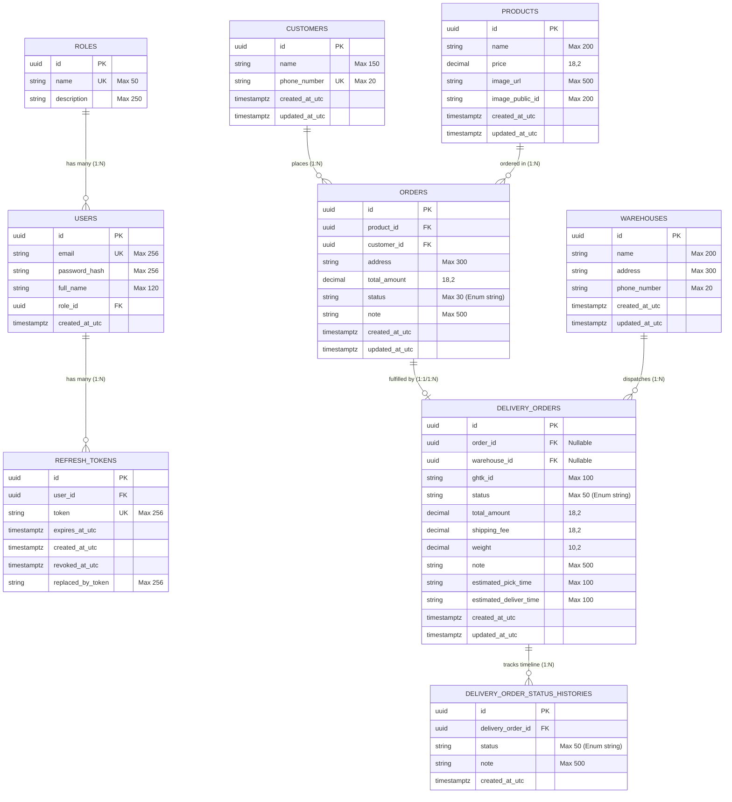

# 🗄️ TÀI LIỆU CẤU TRÚC ENTITY & DATABASE (ThinhPhat System)

Tài liệu này mô tả chi tiết toàn bộ các **Thực thể (Entities)**, **Bảng Cơ Sở Dữ Liệu (PostgreSQL Tables)**, **Quan hệ (Relationships)**, **Khóa chính/Khóa ngoại/Indexes** và **Quy tắc ràng buộc dữ liệu** trong hệ sinh thái backend **ThinhPhat.Api**.

---

> [!IMPORTANT]
> **Quy Tắc Phân Quyền Thao Tác Dữ Liệu (Entity RBAC):**
> - **Role `Admin`:** Có toàn quyền thực hiện các thao tác **Thêm (Insert), Sửa (Update), Cập nhật trạng thái (Patch), Xóa (Delete)** trên tất cả các Entity (`Users`, `Customers`, `Products`, `Orders`, `Warehouses`, `DeliveryOrders`, `DeliveryOrderStatusHistories`).
> - **Role `User`:** Chỉ có quyền truy vấn dữ liệu (Read/Query) hoặc thao tác các tác vụ được giới hạn theo phiên làm việc.

---

## 📌 MỤC LỤC
1. [Sơ Đồ Quan Hệ Thực Thể (ERD - Entity Relationship Diagram)](#1-sơ-đồ-quan-hệ-thực-thể-erd---entity-relationship-diagram)
2. [Chi Tiết Từng Entity](#2-chi-tiết-từng-entity)
   - [2.1 Role (`roles`)](#21-role-roles)
   - [2.2 User (`users`)](#22-user-users)
   - [2.3 RefreshToken (`refresh_tokens`)](#23-refreshtoken-refresh_tokens)
   - [2.4 Customer (`customers`)](#24-customer-customers)
   - [2.5 Product (`products`)](#25-product-products)
   - [2.6 Order - Đơn Chốt (`orders`)](#26-order---đơn-chốt-orders)
   - [2.7 Warehouse - Kho Hàng (`warehouses`)](#27-warehouse---kho-hàng-warehouses)
   - [2.8 DeliveryOrder - Đơn Giao Hàng (`delivery_orders`)](#28-deliveryorder---đơn-giao-hàng-delivery_orders)
   - [2.9 DeliveryOrderStatusHistory - Lịch Sử Đơn Giao (`delivery_order_status_histories`)](#29-deliveryorderstatushistory---lịch-sử-đơn-giao-delivery_order_status_histories)
3. [Tổng Hợp Các Enum Liên Kết](#3-tổng-hợp-các-enum-liên-kết)
   - [3.1 OrderStatus](#31-orderstatus)
   - [3.2 DeliveryOrderStatus](#32-deliveryorderstatus)
4. [Các Quy Tắc & Tối Ưu Hệ Thống Cơ Sở Dữ Liệu](#4-các-quy-tắc--tối-ưu-hệ-thống-cơ-sở-dữ-liệu)

---

## 1. Sơ Đồ Quan Hệ Thực Thể (ERD - Entity Relationship Diagram)

---

## 2. Chi Tiết Từng Entity

---

### 2.1 Role (`roles`)
* **Namespace:** `ThinhPhat.Api.Data.Entities.Role`
* **Mô tả:** Bảng lưu danh sách vai trò phân quyền người dùng trong hệ thống.
* **Tên bảng:** `roles`

| Tên trường C# | Cột Database | Kiểu C# | Kiểu PostgreSQL | Khóa / Chỉ mục | Nullable | Mặc định / Ràng buộc | Mô tả |
| :--- | :--- | :--- | :--- | :--- | :--- | :--- | :--- |
| `Id` | `id` | `Guid` | `uuid` | **PK** | ❌ No | - | Mã định danh vai trò |
| `Name` | `name` | `string` | `varchar(50)` | **Index (Unique)** | ❌ No | Max: 50 | Tên vai trò (`Admin`, `User`) |
| `Description` | `description` | `string` | `varchar(250)` | - | ❌ No | Max: 250 | Mô tả vai trò |

* **Quan hệ (Navigation Properties):**
  - `Users` (`ICollection<User>`): Danh sách người dùng thuộc vai trò này (1-N).
* **Dữ liệu khởi tạo mặc định (Seed Data):**
  - `Admin`: `11111111-1111-1111-1111-111111111111` ("System Administrator with full access")
  - `User`: `22222222-2222-2222-2222-222222222222` ("Standard regular user")

---

### 2.2 User (`users`)
* **Namespace:** `ThinhPhat.Api.Data.Entities.User`
* **Mô tả:** Tài khoản người dùng/nhân viên đăng nhập vào hệ thống.
* **Tên bảng:** `users`

| Tên trường C# | Cột Database | Kiểu C# | Kiểu PostgreSQL | Khóa / Chỉ mục | Nullable | Mặc định / Ràng buộc | Mô tả |
| :--- | :--- | :--- | :--- | :--- | :--- | :--- | :--- |
| `Id` | `id` | `Guid` | `uuid` | **PK** | ❌ No | - | Mã người dùng |
| `Email` | `email` | `string` | `varchar(256)` | **Index (Unique)** | ❌ No | Max: 256 | Email đăng nhập (duy nhất) |
| `PasswordHash`| `password_hash` | `string` | `varchar(256)` | - | ❌ No | BCrypt Hash | Mật khẩu đã được băm an toàn |
| `FullName` | `full_name` | `string` | `varchar(120)` | - | ❌ No | Max: 120 | Họ và tên người dùng |
| `RoleId` | `role_id` | `Guid` | `uuid` | **FK** | ❌ No | Ref `roles.id` | Khóa ngoại trỏ đến vai trò |
| `CreatedAtUtc`| `created_at_utc`| `DateTime` | `timestamptz` | - | ❌ No | `timezone('utc', now())` | Thời gian tạo tài khoản (UTC) |

* **Quan hệ (Navigation Properties):**
  - `Role` (`Role?`): Vai trò của người dùng (`OnDelete: Restrict`).
  - `RefreshTokens` (`ICollection<RefreshToken>`): Danh sách Refresh Token cấp cho user này (1-N, `OnDelete: Cascade`).

---

### 2.3 RefreshToken (`refresh_tokens`)
* **Namespace:** `ThinhPhat.Api.Data.Entities.RefreshToken`
* **Mô tả:** Lưu trữ chuỗi refresh token phục vụ cơ chế JWT Token Rotation & bảo mật phiên đăng nhập.
* **Tên bảng:** `refresh_tokens`

| Tên trường C# | Cột Database | Kiểu C# | Kiểu PostgreSQL | Khóa / Chỉ mục | Nullable | Mặc định / Ràng buộc | Mô tả |
| :--- | :--- | :--- | :--- | :--- | :--- | :--- | :--- |
| `Id` | `id` | `Guid` | `uuid` | **PK** | ❌ No | - | Mã định danh token |
| `UserId` | `user_id` | `Guid` | `uuid` | **FK, Index** | ❌ No | Ref `users.id` | Mã user sở hữu token |
| `Token` | `token` | `string` | `varchar(256)` | **Index (Unique)** | ❌ No | Max: 256 | Chuỗi Refresh Token ngẫu nhiên |
| `ExpiresAtUtc`| `expires_at_utc`| `DateTime` | `timestamptz` | - | ❌ No | - | Thời điểm token hết hạn |
| `CreatedAtUtc`| `created_at_utc`| `DateTime` | `timestamptz` | **Index** | ❌ No | `timezone('utc', now())` | Thời điểm tạo token |
| `RevokedAtUtc`| `revoked_at_utc`| `DateTime?`| `timestamptz` | - | ✔️ Yes | `null` | Thời điểm token bị thu hồi/hủy |
| `ReplacedByToken`| `replaced_by_token` | `string?` | `varchar(256)` | - | ✔️ Yes | Max: 256 | Token thay thế mới (Token Rotation) |

* **Computed Properties (C# only):**
  - `IsExpired` => `DateTime.UtcNow >= ExpiresAtUtc`
  - `IsRevoked` => `RevokedAtUtc is not null`
  - `IsActive` => `!IsRevoked && !IsExpired`
* **Indexes:**
  - `token` (Unique)
  - `(user_id, created_at_utc)`: Tra cứu nhanh các phiên hoạt động của 1 user.
* **Quan hệ:** `User` (`OnDelete: Cascade` - Khi xóa User, toàn bộ token bị xóa).

---

### 2.4 Customer (`customers`)
* **Namespace:** `ThinhPhat.Api.Data.Entities.Customer`
* **Mô tả:** Lưu thông tin khách hàng mua hàng (được nhận diện duy nhất qua số điện thoại).
* **Tên bảng:** `customers`

| Tên trường C# | Cột Database | Kiểu C# | Kiểu PostgreSQL | Khóa / Chỉ mục | Nullable | Mặc định / Ràng buộc | Mô tả |
| :--- | :--- | :--- | :--- | :--- | :--- | :--- | :--- |
| `Id` | `id` | `Guid` | `uuid` | **PK** | ❌ No | - | Mã khách hàng |
| `Name` | `name` | `string` | `varchar(150)` | - | ❌ No | Max: 150 | Tên khách hàng |
| `PhoneNumber` | `phone_number` | `string` | `varchar(20)` | **Index (Unique)** | ❌ No | Max: 20 | Số điện thoại khách (duy nhất) |
| `CreatedAtUtc`| `created_at_utc`| `DateTime` | `timestamptz` | - | ❌ No | `timezone('utc', now())` | Ngày tạo khách hàng |
| `UpdatedAtUtc`| `updated_at_utc`| `DateTime?`| `timestamptz` | - | ✔️ Yes | `null` | Ngày cập nhật gần nhất |

---

### 2.5 Product (`products`)
* **Namespace:** `ThinhPhat.Api.Data.Entities.Product`
* **Mô tả:** Danh mục sản phẩm bán hàng kèm hình ảnh lưu trên Cloudinary.
* **Tên bảng:** `products`

| Tên trường C# | Cột Database | Kiểu C# | Kiểu PostgreSQL | Khóa / Chỉ mục | Nullable | Mặc định / Ràng buộc | Mô tả |
| :--- | :--- | :--- | :--- | :--- | :--- | :--- | :--- |
| `Id` | `id` | `Guid` | `uuid` | **PK** | ❌ No | - | Mã sản phẩm |
| `Name` | `name` | `string` | `varchar(200)` | **Index** | ❌ No | Max: 200 | Tên sản phẩm |
| `Price` | `price` | `decimal` | `numeric(18,2)` | - | ❌ No | Precision: 18,2 | Đơn giá sản phẩm |
| `ImageUrl` | `image_url` | `string` | `varchar(500)` | - | ❌ No | Max: 500 | Đường dẫn URL ảnh (Cloudinary) |
| `ImagePublicId`| `image_public_id` | `string?` | `varchar(200)` | - | ✔️ Yes | Max: 200 | Public ID trên Cloudinary (để dọn dẹp) |
| `CreatedAtUtc`| `created_at_utc`| `DateTime` | `timestamptz` | - | ❌ No | `timezone('utc', now())` | Ngày tạo sản phẩm |
| `UpdatedAtUtc`| `updated_at_utc`| `DateTime?`| `timestamptz` | - | ✔️ Yes | `null` | Ngày cập nhật gần nhất |

---

### 2.6 Order - Đơn Chốt (`orders`)
* **Namespace:** `ThinhPhat.Api.Data.Entities.Order`
* **Mô tả:** Lưu thông tin đơn chốt bán hàng từ nhân viên Telesale / Sale.
* **Tên bảng:** `orders`

| Tên trường C# | Cột Database | Kiểu C# | Kiểu PostgreSQL | Khóa / Chỉ mục | Nullable | Mặc định / Ràng buộc | Mô tả |
| :--- | :--- | :--- | :--- | :--- | :--- | :--- | :--- |
| `Id` | `id` | `Guid` | `uuid` | **PK** | ❌ No | - | Mã đơn chốt |
| `ProductId` | `product_id` | `Guid` | `uuid` | **FK, Index** | ❌ No | Ref `products.id` | Mã sản phẩm chốt |
| `CustomerId` | `customer_id` | `Guid` | `uuid` | **FK, Index** | ❌ No | Ref `customers.id` | Mã khách hàng |
| `Address` | `address` | `string` | `varchar(300)` | - | ❌ No | Max: 300 | Địa chỉ giao hàng chốt |
| `TotalAmount` | `total_amount` | `decimal` | `numeric(18,2)` | - | ❌ No | Precision: 18,2 | Tổng tiền đơn hàng |
| `Status` | `status` | `OrderStatus` | `varchar(30)` | **Index** | ❌ No | Enum (Lưu string dạng text) | Trạng thái đơn chốt |
| `Note` | `note` | `string?` | `varchar(500)` | - | ✔️ Yes | Max: 500 | Ghi chú đơn chốt |
| `CreatedAtUtc`| `created_at_utc`| `DateTime` | `timestamptz` | **Index** | ❌ No | `timezone('utc', now())` | Thời điểm tạo đơn |
| `UpdatedAtUtc`| `updated_at_utc`| `DateTime?`| `timestamptz` | - | ✔️ Yes | `null` | Thời điểm cập nhật đơn |

* **Indexes:**
  - `status`
  - `(customer_id, created_at_utc)`: Tra cứu lịch sử đơn của khách theo thời gian.
  - `(product_id, created_at_utc)`: Thống kê đơn theo sản phẩm theo thời gian.
* **Quan hệ:**
  - `Product` (`OnDelete: Restrict` - Không thể xóa sản phẩm khi đã có đơn chốt).
  - `Customer` (`OnDelete: Restrict` - Không thể xóa khách khi đã có đơn chốt).

---

### 2.7 Warehouse - Kho Hàng (`warehouses`)
* **Namespace:** `ThinhPhat.Api.Data.Entities.Warehouse`
* **Mô tả:** Danh sách kho hàng / điểm xuất hàng cho các đơn giao.
* **Tên bảng:** `warehouses`

| Tên trường C# | Cột Database | Kiểu C# | Kiểu PostgreSQL | Khóa / Chỉ mục | Nullable | Mặc định / Ràng buộc | Mô tả |
| :--- | :--- | :--- | :--- | :--- | :--- | :--- | :--- |
| `Id` | `id` | `Guid` | `uuid` | **PK** | ❌ No | - | Mã định danh kho |
| `Name` | `name` | `string` | `varchar(200)` | **Index** | ❌ No | Max: 200 | Tên kho hàng |
| `Address` | `address` | `string` | `varchar(300)` | - | ❌ No | Max: 300 | Địa chỉ kho lấy hàng |
| `PhoneNumber` | `phone_number` | `string` | `varchar(20)` | **Index** | ❌ No | Max: 20 | Số điện thoại liên hệ tại kho |
| `CreatedAtUtc`| `created_at_utc`| `DateTime` | `timestamptz` | - | ❌ No | `timezone('utc', now())` | Thời điểm tạo kho |
| `UpdatedAtUtc`| `updated_at_utc`| `DateTime?`| `timestamptz` | - | ✔️ Yes | `null` | Thời điểm cập nhật |

---

### 2.8 DeliveryOrder - Đơn Giao Hàng (`delivery_orders`)
* **Namespace:** `ThinhPhat.Api.Data.Entities.DeliveryOrder`
* **Mô tả:** Đơn vận chuyển/giao hàng liên kết với Giao Hàng Tiết Kiệm (GHTK) hoặc tự điều phối nội bộ.
* **Tên bảng:** `delivery_orders`

| Tên trường C# | Cột Database | Kiểu C# | Kiểu PostgreSQL | Khóa / Chỉ mục | Nullable | Mặc định / Ràng buộc | Mô tả |
| :--- | :--- | :--- | :--- | :--- | :--- | :--- | :--- |
| `Id` | `id` | `Guid` | `uuid` | **PK** | ❌ No | - | Mã đơn giao hàng |
| `OrderId` | `order_id` | `Guid?` | `uuid` | **FK, Index** | ✔️ Yes | Ref `orders.id` | Mã đơn chốt gốc (nếu có) |
| `WarehouseId` | `warehouse_id` | `Guid?` | `uuid` | **FK, Index** | ✔️ Yes | Ref `warehouses.id` | Kho xuất hàng |
| `GhtkId` | `ghtk_id` | `string?` | `varchar(100)` | **Index** | ✔️ Yes | Max: 100 | Mã vận đơn GHTK (Tracking Label) |
| `Status` | `status` | `DeliveryOrderStatus` | `varchar(50)` | **Index** | ❌ No | Enum string | Trạng thái giao hàng |
| `TotalAmount` | `total_amount` | `decimal` | `numeric(18,2)` | - | ❌ No | Precision: 18,2 | Tiền thu hộ COD / Tổng giá trị |
| `ShippingFee` | `shipping_fee` | `decimal` | `numeric(18,2)` | - | ❌ No | Precision: 18,2 | Phí vận chuyển |
| `Weight` | `weight` | `decimal` | `numeric(10,2)` | - | ❌ No | Precision: 10,2 | Khối lượng kiện hàng (kg) |
| `Note` | `note` | `string?` | `varchar(500)` | - | ✔️ Yes | Max: 500 | Ghi chú đơn giao hàng |
| `EstimatedPickTime` | `estimated_pick_time` | `string?` | `varchar(100)` | - | ✔️ Yes | Max: 100 | Thời gian lấy hàng dự kiến từ GHTK |
| `EstimatedDeliverTime` | `estimated_deliver_time` | `string?` | `varchar(100)` | - | ✔️ Yes | Max: 100 | Thời gian giao hàng dự kiến từ GHTK |
| `CreatedAtUtc`| `created_at_utc`| `DateTime` | `timestamptz` | **Index** | ❌ No | `timezone('utc', now())` | Thời điểm tạo đơn giao |
| `UpdatedAtUtc`| `updated_at_utc`| `DateTime?`| `timestamptz` | - | ✔️ Yes | `null` | Thời điểm cập nhật |

* **Indexes tối ưu hiệu năng cao:**
  - `ghtk_id`: Tra cứu siêu tốc khi nhận webhook từ GHTK.
  - `status`: Lọc danh sách đơn theo trạng thái (Đang giao, Chờ tiếp nhận,...).
  - `created_at_utc`: Sắp xếp phân trang và lọc theo ngày.
  - `(status, created_at_utc)`: Composite index tối ưu truy vấn lọc trạng thái kết hợp sắp xếp thời gian.
  - `order_id`: Tra cứu theo đơn chốt.
  - `warehouse_id`: Tra cứu theo kho hàng.
* **Quan hệ:**
  - `Order` (`OnDelete: SetNull` - Nếu xóa đơn chốt gốc, đơn giao hàng vẫn được lưu lại).
  - `Warehouse` (`OnDelete: SetNull` - Nếu xóa kho, đơn giao hàng giữ nguyên).
  - `StatusHistories` (`ICollection<DeliveryOrderStatusHistory>`): Danh sách lịch sử trạng thái (`OnDelete: Cascade`).

---

### 2.9 DeliveryOrderStatusHistory - Lịch Sử Đơn Giao (`delivery_order_status_histories`)
* **Namespace:** `ThinhPhat.Api.Data.Entities.DeliveryOrderStatusHistory`
* **Mô tả:** Lưu vết toàn bộ dòng thời gian (timeline) các lần chuyển trạng thái của đơn giao hàng (do nhân viên cập nhật hoặc do GHTK webhook callback).
* **Tên bảng:** `delivery_order_status_histories`

| Tên trường C# | Cột Database | Kiểu C# | Kiểu PostgreSQL | Khóa / Chỉ mục | Nullable | Mặc định / Ràng buộc | Mô tả |
| :--- | :--- | :--- | :--- | :--- | :--- | :--- | :--- |
| `Id` | `id` | `Guid` | `uuid` | **PK** | ❌ No | - | Mã bản ghi lịch sử |
| `DeliveryOrderId` | `delivery_order_id` | `Guid` | `uuid` | **FK, Index** | ❌ No | Ref `delivery_orders.id` | Mã đơn giao hàng |
| `Status` | `status` | `DeliveryOrderStatus` | `varchar(50)` | **Index** | ❌ No | Enum string | Trạng thái tại thời điểm ghi nhận |
| `Note` | `note` | `string?` | `varchar(500)` | - | ✔️ Yes | Max: 500 | Ghi chú / Lý do chuyển trạng thái |
| `CreatedAtUtc`| `created_at_utc`| `DateTime` | `timestamptz` | **Index** | ❌ No | `timezone('utc', now())` | Thời điểm diễn ra sự kiện (UTC) |

* **Indexes:**
  - `(delivery_order_id, created_at_utc)`: Lấy toàn bộ timeline của 1 đơn giao hàng theo thứ tự thời gian cực nhanh.
  - `status`: Thống kê tần suất và tra cứu lịch sử theo trạng thái.
* **Quan hệ:** `DeliveryOrder` (`OnDelete: Cascade` - Khi xóa đơn giao hàng, toàn bộ lịch sử trạng thái bị xóa theo).

---

## 3. Tổng Hợp Các Enum Liên Kết

### 3.1 OrderStatus
* **Namespace:** `ThinhPhat.Api.Data.Entities.OrderStatus`
* **Lưu trong DB:** String (`varchar(30)`)

| Tên Enum | Giá trị Số (Integer Value) | Tên lưu DB (String) | Tên hiển thị (Tiếng Việt) | Ý nghĩa nghiệp vụ |
| :--- | :---: | :--- | :--- | :--- |
| `New` | `1` | `New` | **Mới tạo** | Đơn vừa được Telesale nhập vào |
| `Confirmed` | `2` | `Confirmed` | **Chốt đơn** | Khách đã xác nhận mua hàng |
| `NoAnswer` | `3` | `NoAnswer` | **Không nghe máy** | Gọi cho khách nhưng không bắt máy |
| `Cancelled` | `4` | `Cancelled` | **Không mua** | Khách hủy/từ chối mua |
| `Uploaded` | `5` | `Uploaded` | **Đã up đơn** | Đã tạo đơn giao hàng tương ứng |
| `OutOfStock` | `6` | `OutOfStock` | **Hết hàng** | Tạm hết hàng trong kho |

---

### 3.2 DeliveryOrderStatus
* **Namespace:** `ThinhPhat.Api.Data.Entities.DeliveryOrderStatus`
* **Lưu trong DB:** String (`varchar(50)`)
* **Tương thích:** Đồng bộ 100% với hệ thống mã trạng thái của **Giao Hàng Tiết Kiệm (GHTK)**.

| Tên Enum | Mã Số (GHTK Status ID) | Tên lưu DB (String) | Nhãn hiển thị Tiếng Việt |
| :--- | :---: | :--- | :--- |
| `Cancelled` | `-1` | `Cancelled` | Hủy đơn hàng |
| `Draft` | `0` | `Draft` | Nháp |
| `Pending` | `1` | `Pending` | Chưa tiếp nhận |
| `Accepted` | `2` | `Accepted` | Đã tiếp nhận |
| `PickedOrStocked` | `3` | `PickedOrStocked` | Đã lấy hàng/Đã nhập kho |
| `Delivering` | `4` | `Delivering` | Đã điều phối giao hàng/Đang giao hàng |
| `DeliveredUnreconciled`| `5` | `DeliveredUnreconciled`| Đã giao hàng/Chưa đối soát |
| `Reconciled` | `6` | `Reconciled` | Đã đối soát |
| `CannotPick` | `7` | `CannotPick` | Không lấy được hàng |
| `DelayPick` | `8` | `DelayPick` | Hoãn lấy hàng |
| `CannotDeliver` | `9` | `CannotDeliver` | Không giao được hàng |
| `DelayDelivery` | `10` | `DelayDelivery` | Delay giao hàng |
| `ReturnReconciled` | `11` | `ReturnReconciled` | Đã đối soát công nợ trả hàng |
| `Picking` | `12` | `Picking` | Đã điều phối lấy hàng/Đang lấy hàng |
| `Compensated` | `13` | `Compensated` | Đơn hàng bồi hoàn |
| `Returning` | `20` | `Returning` | Đang trả hàng (COD cầm hàng đi trả) |
| `Returned` | `21` | `Returned` | Đã trả hàng (COD đã trả xong hàng) |
| `ShipperReportedDelivered` | `45` | `ShipperReportedDelivered` | Shipper báo đã giao hàng |
| `ShipperReportedCannotDeliver` | `49` | `ShipperReportedCannotDeliver` | Shipper báo không giao được hàng |
| `ShipperReportedPicked` | `123` | `ShipperReportedPicked` | Shipper báo đã lấy hàng |
| `ShipperReportedCannotPick` | `127` | `ShipperReportedCannotPick` | Shipper báo không lấy được hàng |
| `ShipperReportedDelayPick` | `128` | `ShipperReportedDelayPick` | Shipper báo delay lấy hàng |
| `ShipperReportedDelayDelivery` | `410` | `ShipperReportedDelayDelivery`| Shipper báo delay giao hàng |

---

## 4. Các Quy Tắc & Tối Ưu Hệ Thống Cơ Sở Dữ Liệu

1. **Chuẩn hóa Thời Gian (Timezone Handling):**
   - Mọi cột thời gian đều sử dụng kiểu `timestamp with time zone` (`timestamptz`).
   - Mặc định khởi tạo trên PostgreSQL: `timezone('utc', now())`.
   - C# code luôn thao tác bằng `DateTime.UtcNow`.
2. **Quy tắc Chuyển Đổi Enum (Enum Conversion):**
   - Các Enum (`OrderStatus`, `DeliveryOrderStatus`) được lưu dưới dạng chuỗi `varchar` trong database (`.HasConversion<string>()`) để dữ liệu trong bảng trực quan, dễ đọc khi query trực tiếp SQL và hạn chế lỗi dịch chuyển giá trị enum khi nâng cấp code.
3. **Chiến lược Ràng Buộc Khóa Ngoại (Delete Behaviors):**
   - **`Restrict`**: Dùng cho `Users -> Roles`, `Orders -> Products`, `Orders -> Customers`. Ngăn chặn việc vô tình xóa sản phẩm/khách hàng/vai trò khi đang có dữ liệu đơn hàng liên kết.
   - **`SetNull`**: Dùng cho `DeliveryOrders -> Orders`, `DeliveryOrders -> Warehouses`. Đảm bảo đơn giao hàng và công nợ/lịch sử không bị mất khi xóa đơn chốt hoặc xóa kho.
   - **`Cascade`**: Dùng cho `RefreshTokens -> Users`, `DeliveryOrderStatusHistories -> DeliveryOrders`. Tự động xóa sạch dữ liệu phụ thuộc khi thực thể cha bị xóa.
4. **Tối ưu Index & Phân trang:**
   - Sử dụng Composite Indexes: `(status, created_at_utc)`, `(customer_id, created_at_utc)`, `(delivery_order_id, created_at_utc)` để đảm bảo truy vấn lọc và sắp xếp phân trang đạt độ phức tạp `O(log N)` ngay cả khi dữ liệu hàng triệu dòng.
