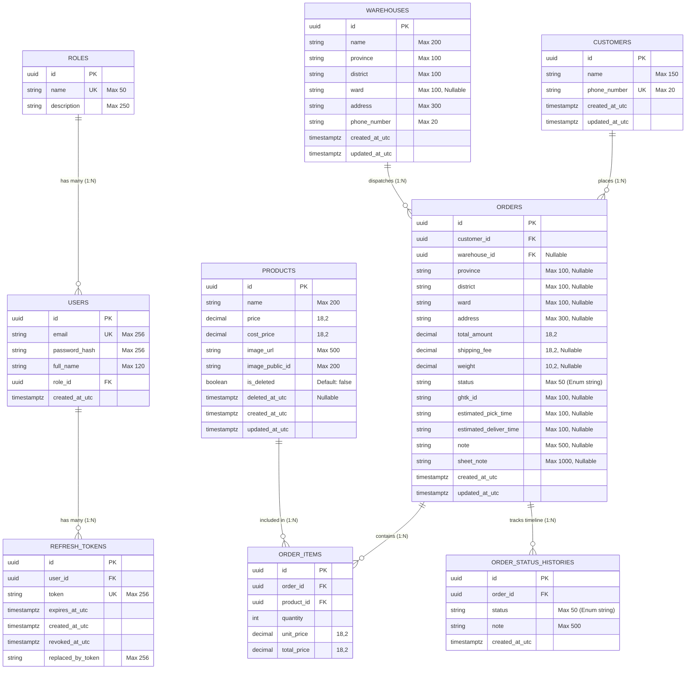

# 🗄️ TÀI LIỆU CẤU TRÚC ENTITY & DATABASE (ThinhPhat System)

Tài liệu này mô tả chi tiết toàn bộ các **Thực thể (Entities)**, **Bảng Cơ Sở Dữ Liệu (PostgreSQL Tables)**, **Quan hệ (Relationships)**, **Khóa chính/Khóa ngoại/Indexes** và **Quy tắc ràng buộc dữ liệu** trong hệ sinh thái backend **ThinhPhat.Api**.

---

> [!IMPORTANT]
> **Quy Tắc Phân Quyền Thao Tác Dữ Liệu (Entity RBAC):**
> - **Role `Admin`:** Có toàn quyền thực hiện các thao tác **Thêm (Insert), Sửa (Update), Cập nhật trạng thái (Patch), Xóa (Delete)** trên tất cả các Entity (`Users`, `Customers`, `Products`, `Orders`, `OrderItems`, `OrderStatusHistories`, `Warehouses`).
> - **Role `User`:** Chỉ có quyền truy vấn dữ liệu (Read/Query) hoặc thao tác các tác vụ được giới hạn theo phiên làm việc.

---

## 📌 MỤC LỤC
1. [Sơ Đồ Quan Hệ Thực Thể (ERD - Entity Relationship Diagram)](#1-sơ-đồ-quan-hệ-thực-thể-erd---entity-relationship-diagram)
2. [Chi Tiết Từng Entity](#2-chi-tiết-từng-entity)
   - [2.1 Role (`roles`)](#21-role-roles)
   - [2.2 User (`users`)](#22-user-users)
   - [2.3 RefreshToken (`refresh_tokens`)](#23-refreshtoken-refresh_tokens)
   - [2.4 Customer (`customers`)](#24-customer-customers)
   - [2.5 Product (`products`)](#25-product-products)
   - [2.6 Order - Đơn Hàng Tích Hợp (`orders`)](#26-order---đơn-hàng-tích-hợp-orders)
   - [2.7 OrderItem - Chi Tiết Sản Phẩm Đơn Hàng (`order_items`)](#27-orderitem---chi-tiết-sản-phẩm-đơn-hàng-order_items)
   - [2.8 OrderStatusHistory - Lịch Sử Trạng Thái Đơn Hàng (`order_status_histories`)](#28-orderstatushistory---lịch-sử-trạng-thái-đơn-hàng-order_status_histories)
   - [2.9 Warehouse - Kho Hàng (`warehouses`)](#29-warehouse---kho-hàng-warehouses)
3. [Tổng Hợp Các Enum Liên Kết](#3-tổng-hợp-các-enum-liên-kết)
   - [3.1 OrderStatus (Telesale & GHTK)](#31-orderstatus-telesale--ghtk)
4. [Các Quy Tắc & Tối Ưu Hệ Thống Cơ Sở Dữ Liệu](#4-các-quy-tắc--tối-ưu-hệ-thống-cơ-sở-dữ-liệu)

---

## 1. Sơ Đồ Quan Hệ Thực Thể (ERD - Entity Relationship Diagram)

---

## 2. Chi Tiết Từng Entity

### 2.1 Role (`roles`)
Lưu danh sách vai trò phân quyền.

| Cột | Kiểu CSDL | Ràng buộc | Diễn giải |
| :--- | :--- | :--- | :--- |
| `id` | `uuid` | `PK`, `NOT NULL` | Định danh vai trò |
| `name` | `varchar(50)` | `NOT NULL`, `UNIQUE` | Tên vai trò (`Admin`, `User`) |
| `description`| `varchar(250)`| `NULL` | Mô tả chi tiết vai trò |

---

### 2.2 User (`users`)
Lưu danh sách tài khoản nhân viên / quản trị viên.

| Cột | Kiểu CSDL | Ràng buộc | Diễn giải |
| :--- | :--- | :--- | :--- |
| `id` | `uuid` | `PK`, `NOT NULL` | Định danh tài khoản |
| `email` | `varchar(256)`| `NOT NULL`, `UNIQUE` | Email đăng nhập |
| `password_hash`| `varchar(256)`| `NOT NULL` | Mật khẩu băm (BCrypt) |
| `full_name` | `varchar(120)`| `NOT NULL` | Họ và tên |
| `role_id` | `uuid` | `FK (roles.id)`, `NOT NULL` | Khóa ngoại tới vai trò |
| `created_at_utc`| `timestamptz` | `NOT NULL`, Default: `UTC` | Thời điểm tạo tài khoản |

---

### 2.3 Customer (`customers`)
Lưu danh sách khách hàng đặt hàng.

| Cột | Kiểu CSDL | Ràng buộc | Diễn giải |
| :--- | :--- | :--- | :--- |
| `id` | `uuid` | `PK`, `NOT NULL` | Định danh khách hàng |
| `name` | `varchar(150)`| `NOT NULL` | Tên khách hàng |
| `phone_number`| `varchar(20)` | `NOT NULL`, `UNIQUE` | Số điện thoại duy nhất |
| `created_at_utc`| `timestamptz` | `NOT NULL`, Default: `UTC` | Thời gian tạo |
| `updated_at_utc`| `timestamptz` | `NULL` | Thời gian cập nhật |

---

### 2.4 Product (`products`)
Lưu thông tin sản phẩm kinh doanh (hỗ trợ Soft Delete).

| Cột | Kiểu CSDL | Ràng buộc | Diễn giải |
| :--- | :--- | :--- | :--- |
| `id` | `uuid` | `PK`, `NOT NULL` | Định danh sản phẩm |
| `name` | `varchar(200)`| `NOT NULL`, Index | Tên sản phẩm |
| `price` | `numeric(18,2)`| `NOT NULL` | Giá bán lẻ mặc định |
| `cost_price` | `numeric(18,2)`| `NOT NULL`, Default: `0` | Giá nhập vốn của sản phẩm |
| `image_url` | `varchar(500)`| `NOT NULL` | Đường dẫn ảnh CDN (Cloudinary) |
| `image_public_id`| `varchar(200)`| `NULL` | Public ID quản lý ảnh trên Cloudinary |
| `is_deleted` | `boolean` | `NOT NULL`, Default: `false`, Index | Đánh dấu xóa mềm / Ngừng kinh doanh |
| `deleted_at_utc`| `timestamptz` | `NULL` | Thời điểm xóa mềm |
| `created_at_utc`| `timestamptz` | `NOT NULL`, Default: `UTC` | Thời gian tạo |
| `updated_at_utc`| `timestamptz` | `NULL` | Thời gian cập nhật |

---

### 2.5 Order - Đơn Hàng Tích Hợp (`orders`)
Bảng quản lý tập trung toàn bộ vòng đời đơn hàng: từ lúc khách đặt (Lead / Draft), Telesale gọi chốt, cho đến khi gửi vận đơn GHTK và thu tiền COD.

| Cột | Kiểu CSDL | Ràng buộc | Diễn giải |
| :--- | :--- | :--- | :--- |
| `id` | `uuid` | `PK`, `NOT NULL` | Mã định danh đơn hàng (Dùng làm `partner_id` gửi GHTK) |
| `customer_id` | `uuid` | `FK (customers.id)`, `NOT NULL` | Khách hàng nhận đơn |
| `warehouse_id` | `uuid` | `FK (warehouses.id)`, `NULL` | Kho xuất hàng (gán khi chốt đơn gửi GHTK) |
| `province` | `varchar(100)`| `NULL` | Tỉnh / Thành phố người nhận |
| `district` | `varchar(100)`| `NULL` | Quận / Huyện người nhận |
| `ward` | `varchar(100)`| `NULL` | Phường / Xã người nhận |
| `address` | `varchar(300)`| `NULL` | Địa chỉ nhận hàng chi tiết (Số nhà, tên đường) |
| `total_amount` | `numeric(18,2)`| `NOT NULL` | Tổng số tiền đơn hàng (Tiền hàng + Phí ship) |
| `shipping_fee` | `numeric(18,2)`| `NULL` | Phí vận chuyển GHTK (Gán khi chốt đơn / Đẩy GHTK) |
| `weight` | `numeric(10,2)`| `NULL` | Khối lượng gói hàng (kg / gram) |
| `status` | `varchar(50)` | `NOT NULL`, Index | Trạng thái vòng đời đơn hàng (`OrderStatus`) |
| `ghtk_id` | `varchar(100)`| `NULL`, Index | Mã vận đơn GHTK (`label_id`) |
| `estimated_pick_time`| `varchar(100)`| `NULL` | Thời gian GHTK dự kiến lấy hàng |
| `estimated_deliver_time`| `varchar(100)`| `NULL` | Thời gian GHTK dự kiến giao hàng |
| `note` | `varchar(500)`| `NULL` | Ghi chú đơn hàng / Ghi chú giao hàng |
| `sheet_note` | `varchar(1000)`| `NULL` | Ghi chú đồng bộ từ Google Sheet (Cột E) |
| `created_at_utc`| `timestamptz` | `NOT NULL`, Default: `UTC` | Thời gian tạo đơn |
| `updated_at_utc`| `timestamptz` | `NULL` | Thời gian cập nhật đơn |

---

### 2.6 OrderItem - Chi Tiết Sản Phẩm Đơn Hàng (`order_items`)
Lưu danh sách các mặt hàng và số lượng trong 1 đơn hàng (Quan hệ 1 - N với `orders`).

| Cột | Kiểu CSDL | Ràng buộc | Diễn giải |
| :--- | :--- | :--- | :--- |
| `id` | `uuid` | `PK`, `NOT NULL` | Định danh mục hàng |
| `order_id` | `uuid` | `FK (orders.id)`, `NOT NULL`, `Cascade` | Đơn hàng sở hữu |
| `product_id` | `uuid` | `FK (products.id)`, `NOT NULL`, `Restrict` | Sản phẩm được mua |
| `quantity` | `integer` | `NOT NULL`, `> 0` | Số lượng sản phẩm |
| `unit_price` | `numeric(18,2)`| `NOT NULL` | Đơn giá thực tế tại thời điểm chốt đơn |
| `total_price` | `numeric(18,2)`| `NOT NULL` | Thành tiền (`quantity * unit_price`) |

---

### 2.7 OrderStatusHistory - Lịch Sử Trạng Thái Đơn Hàng (`order_status_histories`)
Lưu nhật ký hành trình của đơn hàng từ Telesale đến các sự kiện giao vận do GHTK Webhook gửi về.

| Cột | Kiểu CSDL | Ràng buộc | Diễn giải |
| :--- | :--- | :--- | :--- |
| `id` | `uuid` | `PK`, `NOT NULL` | Định danh bản ghi lịch sử |
| `order_id` | `uuid` | `FK (orders.id)`, `NOT NULL`, `Cascade` | Đơn hàng được theo dõi |
| `status` | `varchar(50)` | `NOT NULL`, Index | Trạng thái ghi nhận (`OrderStatus`) |
| `note` | `varchar(500)`| `NULL` | Chi tiết diễn giải, lý do hoãn/hủy, số tiền COD |
| `created_at_utc`| `timestamptz` | `NOT NULL`, Default: `UTC` | Thời điểm diễn ra sự kiện |

---

### 2.8 Warehouse - Kho Hàng (`warehouses`)
Lưu địa điểm lấy hàng gửi đơn GHTK.

| Cột | Kiểu CSDL | Ràng buộc | Diễn giải |
| :--- | :--- | :--- | :--- |
| `id` | `uuid` | `PK`, `NOT NULL` | Định danh kho hàng |
| `name` | `varchar(200)`| `NOT NULL`, Index | Tên kho hàng |
| `province` | `varchar(100)`| `NOT NULL`, Default: `''` | Tỉnh / Thành phố kho hàng |
| `district` | `varchar(100)`| `NOT NULL`, Default: `''` | Quận / Huyện kho hàng |
| `ward` | `varchar(100)`| `NULL` | Phường / Xã kho hàng |
| `address` | `varchar(300)`| `NOT NULL` | Địa chỉ lấy hàng GHTK (Số nhà, tên đường) |
| `phone_number`| `varchar(20)` | `NOT NULL`, Index | SĐT liên hệ của kho |
| `created_at_utc`| `timestamptz` | `NOT NULL`, Default: `UTC` | Thời gian tạo |
| `updated_at_utc`| `timestamptz` | `NULL` | Thời gian cập nhật |

---

## 3. Tổng Hợp Các Enum Liên Kết

### 3.1 OrderStatus (Telesale & GHTK)

Hệ thống sử dụng quy ước phân tách giá trị nguyên:
* **Giá trị $\le 0$:** Giai đoạn Telesale (Khách đặt, gọi điện, chốt/hủy).
* **Giá trị $> 0$:** Giai đoạn giao vận GHTK (Trùng khớp 100% mã `status_id` của Giao Hàng Tiết Kiệm).

| Enum Name | Mã Số (int) | Tên Hiển Thị Tiếng Việt | Phân Nhóm |
| :--- | :---: | :--- | :--- |
| `Draft` | `0` | Nháp (Lead mới từ Web/Landing Page) | Telesale |
| `New` | `-1` | Mới tạo - Chờ nhân viên gọi điện | Telesale |
| `NoAnswer` | `-2` | Không nghe máy | Telesale |
| `CallbackLater` | `-3` | Hẹn gọi lại sau | Telesale |
| `Cancelled` | `-4` | Khách hủy / Không mua | Telesale / GHTK |
| `OutOfStock` | `-5` | Hết hàng | Telesale |
| `Duplicate` | `-6` | Trùng đơn | Telesale |
| `Confirmed` | `1` | Đã chốt đơn / Chưa tiếp nhận (GHTK: 1) | GHTK / Fulfillment |
| `Accepted` | `2` | Đã tiếp nhận (GHTK: 2) | GHTK / Fulfillment |
| `PickedOrStocked` | `3` | Đã lấy hàng / Đã nhập kho (GHTK: 3) | GHTK / Fulfillment |
| `Delivering` | `4` | Đang giao hàng (GHTK: 4) | GHTK / Fulfillment |
| `DeliveredUnreconciled`| `5` | Đã giao hàng / Chưa đối soát (GHTK: 5)| GHTK / Fulfillment |
| `Reconciled` | `6` | Đã đối soát (GHTK: 6) | GHTK / Fulfillment |
| `CannotPick` | `7` | Không lấy được hàng (GHTK: 7) | GHTK / Fulfillment |
| `DelayPick` | `8` | Hoãn lấy hàng (GHTK: 8) | GHTK / Fulfillment |
| `CannotDeliver` | `9` | Không giao được hàng (GHTK: 9) | GHTK / Fulfillment |
| `DelayDelivery` | `10` | Delay giao hàng (GHTK: 10) | GHTK / Fulfillment |
| `ReturnReconciled` | `11` | Đã đối soát công nợ trả hàng (GHTK: 11)| GHTK / Fulfillment |
| `Picking` | `12` | Đang lấy hàng (GHTK: 12) | GHTK / Fulfillment |
| `Compensated` | `13` | Đơn hàng bồi hoàn (GHTK: 13) | GHTK / Fulfillment |
| `Returning` | `20` | Đang trả hàng (GHTK: 20) | GHTK / Fulfillment |
| `Returned` | `21` | Đã trả hàng (GHTK: 21) | GHTK / Fulfillment |
| `ShipperReportedPicked` | `123` | Shipper báo đã lấy hàng | GHTK Shipper |
| `ShipperReportedCannotPick` | `127` | Shipper báo không lấy được hàng | GHTK Shipper |
| `ShipperReportedDelayPick` | `128` | Shipper báo delay lấy hàng | GHTK Shipper |
| `ShipperReportedDelivered` | `45` | Shipper báo đã giao hàng | GHTK Shipper |
| `ShipperReportedCannotDeliver` | `49` | Shipper báo không giao được hàng | GHTK Shipper |
| `ShipperReportedDelayDelivery` | `410` | Shipper báo delay giao hàng | GHTK Shipper |

---

## 4. Các Quy Tắc & Tối Ưu Hệ Thống Cơ Sở Dữ Liệu

1. **Zero-allocation & AsNoTracking:** Toàn bộ truy vấn đọc (Read-only) đều áp dụng `.AsNoTracking()` để tiết kiệm RAM tối đa trên môi trường Production (Render/Alpine).
2. **Cascade Delete:** Khi xóa một `Order`, tất cả các `OrderItem` và `OrderStatusHistory` liên kết sẽ được tự động xóa theo (Cascade).
3. **Compound Indexes:** Tối ưu hóa việc lọc danh sách đơn hàng kết hợp phân trang thời gian bằng composite index `(Status, CreatedAtUtc)` và `(OrderId, CreatedAtUtc)`.
4. **Idempotent Webhook:** Xử lý Webhook GHTK đảm bảo an toàn, không trùng lặp lịch sử trạng thái nếu GHTK gửi lại cùng một sự kiện nhiều lần.
